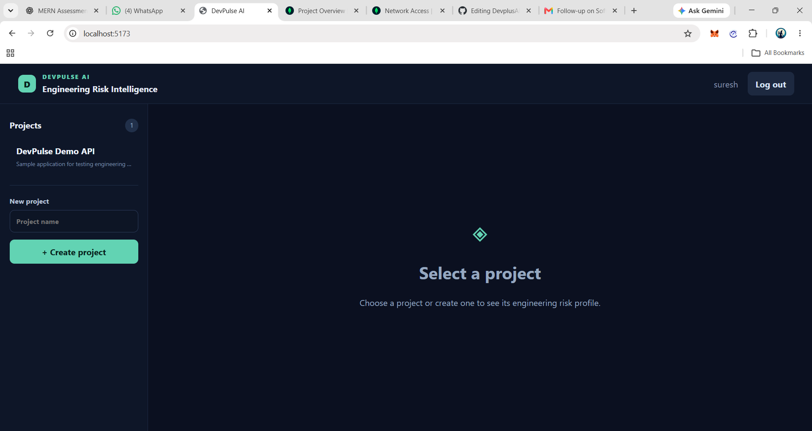
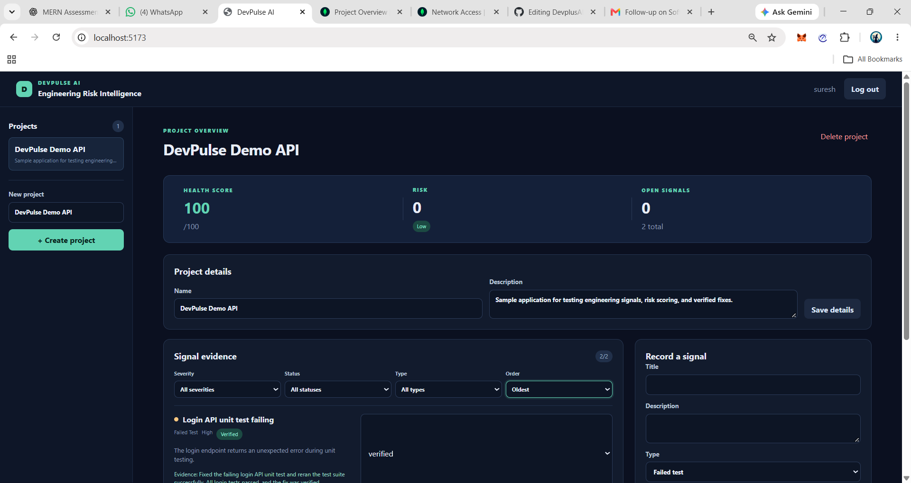
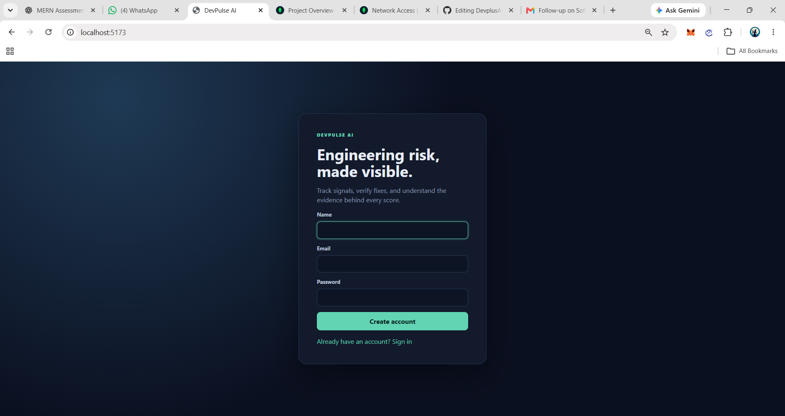

# DevPulse AI — Engineering Risk Intelligence

[](https://github.com/suresh294/DevplusAI/actions/workflows/ci.yml)

**Turn engineering signals into actionable project health insights.**

DevPulse AI is a full-stack engineering risk management application that helps developers record bugs, failed tests, and dependency alerts, track remediation, and understand project health through transparent, deterministic risk scoring.

Built with **React, Node.js, Express, and MongoDB**, the application combines authenticated project management, evidence-based verification, risk history, and a responsive dashboard in one workflow.

> **Project focus:** Full-stack development · REST API design · Authentication and authorization · Risk scoring · Automated testing · Secure application design

## Key Features

- **Secure authentication:** User registration, password hashing with bcryptjs, signed JWT authentication, and token-expiration handling.
- **Project management:** Create, view, update, and delete projects through protected API endpoints.
- **Engineering signal tracking:** Record failed tests, bugs, and dependency alerts with configurable severity levels.
- **Lifecycle management:** Track signals through `open`, `in_progress`, `fixed_unverified`, `verified`, and `reopened` states.
- **Evidence-based verification:** Require non-empty verification evidence before a signal can be marked as verified.
- **Transparent risk scoring:** Calculate project risk using documented severity points, signal types, and status multipliers.
- **Risk history:** Preserve project risk snapshots following relevant signal changes and review historical risk levels.
- **Responsive dashboard:** Present project health, risk breakdowns, signal details, filters, loading states, validation feedback, and API errors.
- **Ownership enforcement:** Protect project and signal operations so users cannot access another user's resources.
- **Testable architecture:** Keep risk calculations independently testable and validate backend behavior with automated regression tests.

## Why This Project Matters

Engineering teams need more than a list of bugs. They need a way to see which issues remain unresolved, whether remediation has progressed, and how those changes affect project health.

DevPulse AI connects these activities in a single workflow:

1. Create a project.
2. Record an engineering signal and assign its severity.
3. Track remediation through defined status transitions.
4. Attach evidence before verifying completed work.
5. Review the calculated risk score and project health.
6. Inspect risk history to understand changes over time.

The scoring logic is deterministic and explainable. The current MVP does not claim to predict future incidents or automatically discover vulnerabilities in external repositories.

## Technology Stack

| Layer | Technologies |
|---|---|
| Frontend | React, Vite, JavaScript, CSS |
| Backend | Node.js, Express.js |
| Database | MongoDB, Mongoose |
| Authentication | JSON Web Tokens (JWT), bcryptjs |
| API | REST, JSON, authenticated requests |
| Testing | Node.js built-in test runner, isolated model mocks |
| Build tooling | Vite, npm |

## Architecture

```text
┌──────────────────────────────┐
│       React Dashboard        │
│ Projects · Signals · History │
└──────────────┬───────────────┘
               │ HTTP / JSON
               ▼
┌──────────────────────────────┐
│       Express REST API       │
│ Validation · Authentication  │
│ Authorization · Error Handling│
└──────────────┬───────────────┘
               │
        ┌──────┴────────┐
        ▼               ▼
┌──────────────┐  ┌────────────────┐
│   MongoDB    │  │ Risk Scoring   │
│ Projects and │  │ Deterministic  │
│ Signals      │  │ Calculations   │
└──────────────┘  └───────┬────────┘
                          ▼
                 ┌────────────────┐
                 │ Risk Snapshots │
                 │ Project History│
                 └────────────────┘
```

The React frontend communicates with the Express API using JSON requests. Protected routes validate the user's authentication and resource ownership. Mongoose handles persistence, while the scoring service calculates risk using explicit rules rather than an opaque predictive model.

The server connects to MongoDB before accepting requests. Its health endpoint reports whether the database connection is healthy.

## Risk Scoring Model

DevPulse AI uses a deterministic scoring formula:

**Signal contribution = (severity points + type points) × status multiplier**

### Severity points

| Severity | Points |
|---|---:|
| Low | 5 |
| Medium | 12 |
| High | 25 |
| Critical | 40 |

### Signal type points

| Signal type | Points |
|---|---:|
| Failed test | 10 |
| Bug | 8 |
| Dependency alert | 12 |

### Status multipliers

| Status | Multiplier |
|---|---:|
| Open | 1.0 |
| In progress | 0.7 |
| Fixed, unverified | 0.5 |
| Verified | 0 |
| Reopened | 1.2 |

The contributions of all signals are summed, rounded to the nearest integer, and capped at 100.

**Project health = 100 − project risk**

| Risk score | Risk level |
|---|---|
| 0–24 | Low |
| 25–49 | Medium |
| 50–74 | High |
| 75–100 | Critical |

These rules make the score reproducible and allow users to understand how a signal affects the overall result. The score is a rule-based indicator, not a statistically validated prediction of production incidents.

## Getting Started

### Prerequisites

- Node.js 18 or newer
- npm
- A MongoDB deployment, such as MongoDB Atlas
- A separate database for integration testing if you run live API tests

### 1. Clone the repository

```bash
git clone https://github.com/suresh294/DevplusAI.git
cd DevplusAI
```

### 2. Configure the backend

Copy `server/.env.example` to `server/.env` and configure the environment variables supported by the application.

At minimum, configure:

```dotenv
MONGODB_URI=your_mongodb_connection_string
JWT_SECRET=your_long_random_secret
CORS_ORIGINS=http://localhost:5173
```

Use a dedicated development database. For production, use a securely generated JWT secret of at least 32 characters, restrict CORS to the exact frontend origins, and keep all credentials outside source control.

### 3. Install dependencies

```bash
npm install --prefix server
npm install --prefix client
```

### 4. Start the backend

```bash
npm start --prefix server
```

### 5. Start the frontend

Open a second terminal in the repository directory:

```bash
npm run dev --prefix client
```

The default local addresses are:

- **Frontend:** http://localhost:5173
- **API:** http://localhost:5000/api
- **Health endpoint:** http://localhost:5000/api/health

If the API is deployed at a different address, configure `VITE_API_BASE_URL` in the frontend environment using the format expected by the application. Restart or rebuild Vite after changing environment variables.

**Security note:** Never commit `.env` files, database connection strings, private keys, passwords, or authentication tokens.

## API Overview

### Public endpoints

| Method | Endpoint | Purpose |
|---|---|---|
| POST | `/api/auth/register` | Register a user |
| POST | `/api/auth/login` | Authenticate a user |
| GET | `/api/health` | Check API and database health |

### Authenticated endpoints

Protected requests use the following header:

```http
Authorization: Bearer <token>
```

| Method | Endpoint | Purpose |
|---|---|---|
| GET | `/api/projects?page=1&limit=20` | List projects |
| POST | `/api/projects` | Create a project |
| GET | `/api/projects/:id` | Retrieve project details |
| PATCH | `/api/projects/:id` | Update a project |
| DELETE | `/api/projects/:id` | Delete a project |
| GET | `/api/projects/:id/risk-history` | Retrieve risk history |
| GET | `/api/projects/:projectId/signals` | List project signals |
| POST | `/api/projects/:projectId/signals` | Create a signal |
| GET | `/api/signals/:id` | Retrieve a signal |
| PATCH | `/api/signals/:id` | Update a signal |
| DELETE | `/api/signals/:id` | Delete a signal |
| PATCH | `/api/signals/:id/status` | Change signal status |

Responses use structured JSON. Errors are returned as sanitized responses rather than intentionally exposing internal implementation details.

## Testing and Quality Checks

The backend uses Node.js's built-in test runner. Its automated suite covers backend behavior using isolated model mocks, so these tests do not require a live MongoDB instance.

Run the backend tests:

```bash
npm test --prefix server
```

Build the frontend for production:

```bash
npm run build --prefix client
```

Check the Git diff for whitespace errors:

```bash
git diff --check
```

Audit client dependencies:

```bash
npm audit --prefix client
```

Audit server production dependencies:

```bash
npm audit --omit=dev --prefix server
```

Audit all server dependencies, including development tooling:

```bash
npm audit --prefix server
```

### Validation results

The following checks were reported as passing during local development:

- **Backend tests:** 34 tests passed, 0 failed.
- **Frontend production build:** Successful.
- **Client dependency audit:** 0 reported vulnerabilities.
- **Production server dependency audit:** 0 reported vulnerabilities.
- **Authentication and API behavior:** Local workflows tested, including project and signal operations, status transitions, evidence validation, refresh persistence, and user ownership isolation.

These results describe the reported development checks, not an independent audit or a guarantee of production security. Run the commands again against the final commit to verify the current repository state.

## Reproducing the Main Workflow

Use a disposable database and test accounts with no real user data.

1. Configure the backend and frontend environment.
2. Register a user and log in.
3. Refresh the page and check session restoration; confirm expired or invalid authentication is rejected.
4. Create a project and inspect its initial risk and health values.
5. Create a signal with a supported type and severity.
6. Change the signal status through permitted transitions.
7. Attempt verification without evidence, then submit valid evidence.
8. Inspect the project's risk history after a relevant mutation.
9. Register a second test user and verify that cross-user project and signal access is denied.
10. Test validation errors, unavailable API behavior, and protected operations after logout.

Run live API tests only against a separate test database. Automated model-mock tests and live database integration tests are different kinds of validation.

## Development Workflow with Code0

Code0 (`frigga.code0`) was used as an AI-assisted development tool during implementation and debugging. Its suggestions were reviewed and evaluated through code changes, automated tests, and local application checks.

### Tasks assisted by Code0

1. **Backend debugging:** Investigated signal-status behavior and risk-history route ordering.
2. **Authentication configuration:** Diagnosed JWT secret configuration issues affecting authentication.
3. **CORS troubleshooting:** Investigated cross-origin requests between the Vite frontend and Express backend.
4. **Regression testing:** Helped identify edge cases and develop tests for previously discovered backend defects.
5. **Security review:** Assisted with reviewing authentication middleware, project ownership checks, and signal authorization workflows.

Code0 assisted development; it was not an autonomous security auditor. AI-generated suggestions were not treated as proof of correctness.

## Known Limitations and Security Considerations

DevPulse AI is an MVP. The current implementation does not:

- Scan live GitHub repositories automatically.
- Apply autonomous code fixes.
- Predict future incidents using a trained machine-learning model.
- Provide enterprise team permissions or billing.
- Depend on an external AI service for its scoring calculations.

Before production deployment, additional operational work is required, including HTTPS, secure secret management and rotation, rate limiting, monitoring, database backups, restricted database network access, and appropriate integration testing.

### Dependency audit findings

The production server dependency audit reported zero vulnerabilities. The full server audit reported three high-severity findings in the development dependency chain:

`nodemon → chokidar → braces`

The findings include the [`braces` advisory GHSA-vfj7-8cjw-p6xm](https://github.com/advisories/GHSA-vfj7-8cjw-p6xm).

The suggested automatic fix would downgrade Nodemon to an older major version, so it was not applied blindly. The development dependency findings remain unresolved and should be reviewed before relying on the development environment in a production workflow. Do not run `npm audit fix --force` without reviewing the resulting dependency changes.

## Project Status

**Status: MVP implemented and tested locally**

DevPulse AI implements the core project and signal management workflows, JWT authentication, ownership checks, evidence-based verification, deterministic risk scoring, and risk history.

### Development validation

- [x] Backend automated tests passed (34 tests).
- [x] Frontend production build completed successfully.
- [x] Client dependency audit reported zero vulnerabilities.
- [x] Production server dependency audit reported zero vulnerabilities.
- [x] Authentication and session restoration tested locally.
- [x] Project and signal workflows tested locally.
- [x] Signal status transitions and verification evidence tested.
- [x] Cross-user resource access restrictions tested.
- [x] Risk history and refresh persistence checked.

### Before production deployment

- [ ] Configure production environment variables and deployment URLs.
- [ ] Configure HTTPS, database access restrictions, monitoring, and backups.
- [ ] Review and resolve or document outstanding development dependency audit findings.
- [ ] Run deployment-specific integration and smoke tests.

The production checklist covers deployment hardening, not missing core application features. DevPulse AI is presented as a functional MVP; production deployment is outside the current scope.

## Application Screenshots

### Project Dashboard


### Signal Details


### Authorization



## Repository

**GitHub:** https://github.com/suresh294/DevplusAI

Built to demonstrate practical full-stack engineering: API development, secure resource access, transparent business logic, regression testing, and maintainable project documentation.